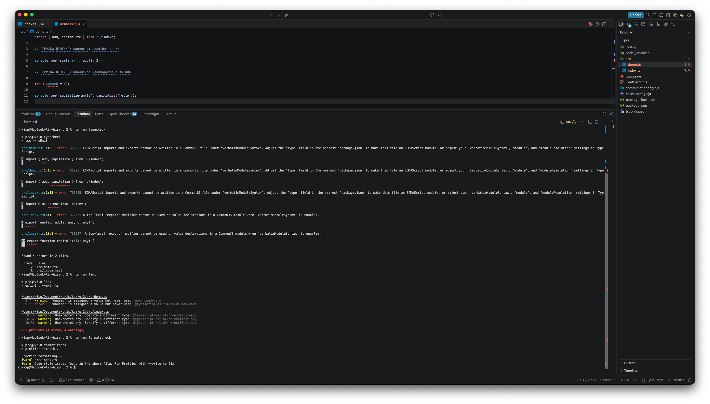
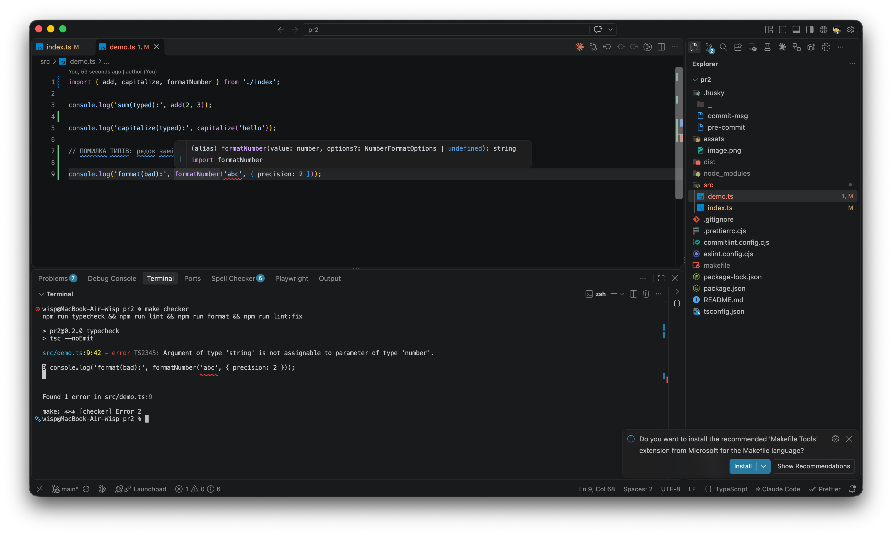

# kpz-pr2

Невелика навчальна TypeScript-бібліотека утиліт: `add`, `capitalize`, `formatNumber`, `groupBy` та клас `Logger`. Конфігурація читається з `.env` і перевіряється через `zod`.

Проєкт показує, як працювати з `package.json`, розділяти `dependencies` і `devDependencies`, вести семантичне версіонування (SemVer) і налаштовувати ESLint, Prettier, Husky та Commitlint. Кожен етап закінчується git-тегом релізу.

## Запуск

```bash
npm i            # встановити залежності (а також husky-хуки через prepare)
npm run demo     # запустити src/demo.ts
npm run build    # зібрати dist/ (CJS + ESM + .d.ts)
```

Перевірки:

```bash
npm run typecheck
npm run lint
npm run format:check
npm run lint:fix && npm run format   # автофікс
```

## Змінні оточення (`.env`)

Файл `.env` лежить у корені проєкту і не потрапляє в репозиторій (він є в `.gitignore`).

```env
APP_PRECISION=3
LOG_LEVEL=debug
```

| Ключ            | Значення                      | За замовчуванням |
| --------------- | ----------------------------- | ---------------- |
| `APP_PRECISION` | ціле число 0–10               | `2`              |
| `LOG_LEVEL`     | `silent` \| `info` \| `debug` | `info`           |

Значення перевіряє `zod` у `src/config.ts`. Якщо значення некоректне, застосунок падає на старті.

## Приклади використання

```ts
import { add, capitalize, formatNumber, groupBy, Logger, type User } from 'pr2';

add([2, 3, 4]); // 9
capitalize('hello'); // 'Hello'

formatNumber(123.456, { precision: 2 }); // '123.46'
formatNumber(123.456); // точність з APP_PRECISION -> '123.456'

const users: User[] = [
  { id: 1, name: 'Alice' },
  { id: 2, name: 'Bob' },
];
groupBy(users, 'name'); // { Alice: [...], Bob: [...] }
groupBy(users, 'age'); // помилка типів: ключа 'age' у User немає

const logger = new Logger('debug');
logger.info('Application started'); // [INFO] Application started
logger.debug('Extra debug info'); // [DEBUG] Extra debug info
```

## Етапи еволюції

| Версія                                                       | Що змінилось                                                                                                                        | Чому така версія                                      |
| ------------------------------------------------------------ | ----------------------------------------------------------------------------------------------------------------------------------- | ----------------------------------------------------- |
| [v0.1.0](https://github.com/kenzoutenma/kpz-pr2/tree/v0.1.0) | `add`, `capitalize` з `any`                                                                                                         | MINOR: перший функціонал                              |
| [v0.2.0](https://github.com/kenzoutenma/kpz-pr2/tree/v0.2.0) | ті самі функції з типами `number` / `string`                                                                                        | MINOR: сумісність збережена                           |
| [v0.3.0](https://github.com/kenzoutenma/kpz-pr2/tree/v0.3.0) | `formatNumber` + type alias `NumberFormatOptions`                                                                                   | MINOR: нова функція                                   |
| [v0.4.0](https://github.com/kenzoutenma/kpz-pr2/tree/v0.4.0) | інтерфейс `User` + generic `groupBy<T>`                                                                                             | MINOR: нова функція                                   |
| [v0.5.0](https://github.com/kenzoutenma/kpz-pr2/tree/v0.5.0) | клас `Logger`, `.env` + `zod`, `formatNumber` бере точність з `APP_PRECISION`                                                       | MINOR: нова функція                                   |
| [v1.0.0](https://github.com/kenzoutenma/kpz-pr2/tree/v1.0.0) | стабільний публічний API (`src/index.ts`), `no-explicit-any: error`, поля `exports`/`types` у `package.json`, код розбито на модулі | MAJOR: фіксація стабільного API                       |
| [v2.0.0](https://github.com/kenzoutenma/kpz-pr2/tree/v2.0.0) | `add(a, b)` → `add(values: number[])`                                                                                               | MAJOR: breaking change, старі виклики не компілюються |

Усі теги: <https://github.com/kenzoutenma/kpz-pr2/tags>

## Перевірки та git-хуки

- `.husky/pre-commit` запускає `npm run lint && npm run format:check && npm run typecheck`.
- `.husky/commit-msg` перевіряє повідомлення через Commitlint (Conventional Commits).

На кожному етапі `src/demo.ts` спочатку містив навмисно неправильні виклики, а потім виправлені.

### Навмисна помилка лінтингу (unused var)



### Навмисна помилка типів


